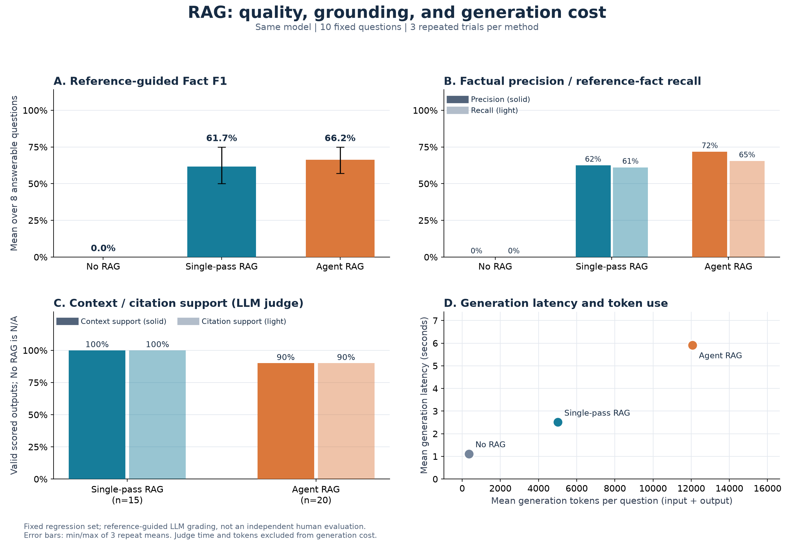
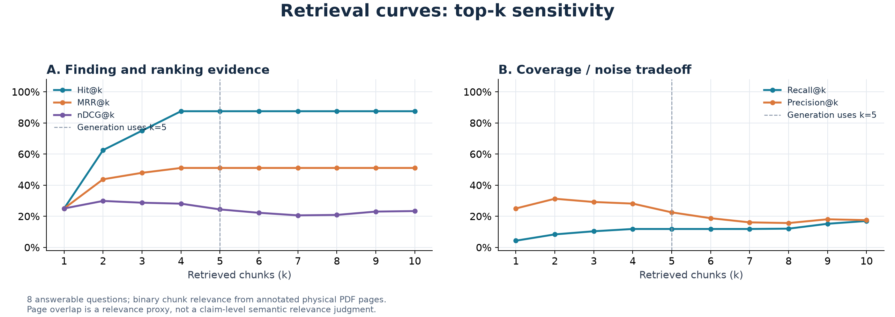

# RAG 導入前後の三方式比較

## 参考にした公開プロジェクト

[Ragas](https://github.com/vibrantlabsai/ragas)、[Haystack](https://github.com/deepset-ai/haystack)、[LlamaIndex](https://github.com/run-llama/llama_index) の評価機能と公開ドキュメントを確認しました。

[Ragas の Factual Correctness](https://docs.ragas.io/en/stable/concepts/metrics/available_metrics/factual_correctness/) と [Faithfulness](https://docs.ragas.io/en/stable/concepts/metrics/available_metrics/faithfulness/) を参考に、事実の正確さ・必要な事実の網羅性・取得文脈による支持を分けます。[Haystack の評価](https://docs.haystack.deepset.ai/docs/evaluation) のように、パイプライン全体の回答評価と検索コンポーネントの評価を分離します。[LlamaIndex の評価ガイド](https://developers.llamaindex.ai/python/framework/module_guides/evaluating/) も、回答と文脈の対応を測る LLM 評価と、MRR・Hit Rate などの検索評価を区別しています。

本プロジェクトはこれらの考え方を参考にした **独自の参照事実付き LLM 採点** を実装しています。Ragas・Haystack・LlamaIndex のライブラリを実行して得た公式スコアではありません。とくに回答適合率は逆質問と Embedding に基づく Ragas Response Relevancy ではなく、質問に関連する主張の割合を採点する独自の補助指標です。

## 実験の条件

| 項目 | 条件 |
| --- | --- |
| 問題 | `baseline-v1.json` の固定 10 問。回答可能 8 問、根拠不足 2 問 |
| 参照事実 | `comparison-facts-v1.json` の 32 項目。実行前に固定 |
| 三方式 | No RAG / Single-pass RAG / Agent RAG |
| 回答モデル | 全方式で `gpt-4.1-mini-2025-04-14` |
| 出力上限 | 回答 2,048 Token / 採点 4,096 Token |
| 検索 | 5 文書・1,037 チャンク、300 Token 分割、初回 `top_k=5` |
| 反復 | 各問題・各方式を 3 回。各方式 30 試行、合計 90 試行 |
| 実行順 | seed `20261102` で問題と方式順をシャッフルし、同一問題の三方式を組にして逐次実行 |
| 採点モデル | 回答モデルと同じモデルを使用。方式名を入力せず、固定した基準・原文で採点 |

seed は実行順と統計計算を固定するもので、LLM の生成を決定的にするものではありません。三方式とも不明な事実を推測せず、一部しか答えられない場合は不足情報を返すよう指示します。

各生成・採点は履歴を引き継がない独立した API リクエストです。同じクライアント接続を使っても、採点に渡した参照事実を次の生成リクエストへ渡すことはありません。

- **No RAG**: 質問だけをモデルへ渡します。文書・取得本文・参照回答は渡さず、検索やツールを呼びません。引用の生成も要求しません。
- **Single-pass RAG**: 同じ質問で 1 回検索して回答します。追加検索・ページ取得・文書一覧参照は行いません。現在の Agent の道具上限を 1 回にすることで、生成指示と引用検証を Agent と共通にします。
- **Agent RAG**: 現在の通常フローです。検索最大 3 回・ページ取得最大 2 回・道具全体最大 6 回で追加調査します。

全方式とも、出力の状態矛盾に対する検証修正は最大 1 回です。RAG の二方式は同じ原文候補 ID と引用検証を使用します。閉じた知識の方式には資料がないため、引用・文脈支持の評価は `N/A` とします。

質問以外の入力や回答形式は方式の制約に合わせて異なります。これはモデルの能力全体を比較する実験ではなく、本プロジェクトで文書検索と追加調査を導入した効果の比較です。

## 回答品質の計算

採点者へ渡すのは、質問、固定した参照事実、正解の物理ページの本文、生成された結論、および RAG 方式で実際に取得・引用した本文です。参照事実と正解ページは回答生成側には渡しません。回答中の数値・年度・単位・対象の対応が正しいかを確認し、キーワードが存在するだけでは正答にしません。

回答を原子的な主張へ分解し、各主張を原文が支持するかと、必要な参照事実を回答が網羅するかを同一の採点指示で判断します。

```text
Fact Precision = 正解の原文で支持できる主張数 / 回答中の全主張数
Fact Recall    = 回答が正しくカバーした参照事実数 / 必要な参照事実数
Fact F1        = 2 × Precision × Recall / (Precision + Recall)
Faithfulness   = 実際の取得文脈で支持できる主張数 / 回答中の全主張数
Citation Support = 当該結論に付いた引用で支持できる主張数 / 回答中の全主張数
```

Fact F1 は回答ごとに計算してから、回答可能な 8 問 × 3 回 = **24 試行を同じ重みで平均** します。全問の Precision と Recall を先に平均してから F1 を計算する方法とは異なります。回答不能・生成エラー・採点エラーは、回答可能な問題では F1 を 0 として分母に残します。エラー件数も別途公開します。

Faithfulness と Citation Support は、有効な回答を生成・採点できた場合の条件付き平均です。無回答を高い支持率として扱わず、適用した回答数も表に示します。No RAG には取得文脈がないため 0% ではなく `N/A` です。

**Task Success** は、回答可能な問題では全参照事実を満たし、誤り・裏付け不明な追加主張がない場合に 1、根拠不足の 2 問では正しく不足を返した場合に 1 とします。各方式の全 30 試行を分母にします。引用が付けられないことだけを理由に No RAG を不合格にすることはありません。

## 検索曲線の計算

回答可能な 8 問を用い、共通の初回検索器から上位 10 チャンクを 1 回取得し、`k=1…10` の各切り口を計算します。Agent の追加調査や回答のスコアをこの曲線に混ぜません。No RAG の検索曲線は定義しません。

正解の物理 PDF ページと重なる全チャンクを関連集合 `R` とする二値ラベルです。上位 k の関連チャンク数を `r_k` とすると、次のように計算します。

```text
Hit@k       = 上位 k に関連チャンクがあれば 1、なければ 0
MRR@k       = 上位 k で最初に関連するチャンクの順位の逆数、なければ 0
Precision@k = r_k / k
Recall@k    = r_k / |R|
DCG@k       = Σ relevance_i / log2(i + 1)
nDCG@k      = DCG@k / 理想的な関連順での DCG@k
```

正規化の理想順位には、上位 10 件に実際に出たチャンクだけでなく、正解ページに対応する全関連チャンク数を使用します。各指標を 8 問で平均します。

ページとの交差は粗い関連ラベルであり、同じページの無関係な文章も関連として数え得ます。代替の根拠ページも含むため、Recall@k が低いだけで回答に必要な証拠が足りないとは限りません。Ragas の意味的な Context Recall と同一ではありません。曲線は実際に取得した上位 k に基づくもので、学習曲線や架空の反復改善曲線ではありません。

## 改善幅と変動

RAG の F1 と No RAG の F1 の差を **パーセントポイント（pp）** で示します。相対改善率は `(RAG − No RAG) / No RAG` で計算し、No RAG が 0 の場合は未定義として表示しません。

各問題の 3 回の平均を一つの組にまとめ、8 問の対応差を問題単位で 5,000 回再標本化した 95% bootstrap 区間を併記します。同じ問題の 3 試行を独立した新しい 3 問として扱いません。図の誤差棒は別の量で、3 回それぞれの平均の最小・最大です。

比較対象はすでに開発と失敗分析に使った小規模な回帰集合です。問題を固定して公平に比較しますが、未知の企業・文書・質問への汎化や統計的な有意差は主張しません。採点者も回答モデルと同じ LLM であり、独立した人手による正答率ではありません。採点者の誤り・自己評価バイアスは残ります。

## 再実行と公開データ

```bash
uv sync --locked --group eval

# 初回は既存の文書・分割・Embedding を準備する。手順は baseline.md を参照。
uv run --locked --group eval doc-agent compare-rag \
  --repeats 3 --seed 20261102 \
  --output data/reports/rag-comparison-v1-20261102.json \
  --public-output docs/assets/rag-comparison-v1.json

# 同じ問題・コード・設定・コーパスで中断地点から再開する場合
uv run --locked --group eval doc-agent compare-rag \
  --repeats 3 --seed 20261102 --resume \
  --output data/reports/rag-comparison-v1-20261102.json \
  --public-output docs/assets/rag-comparison-v1.json

# 公開した数値だけから図を再生成。API キー・DB・追加の API 呼び出しは不要。
uv run --locked --group eval doc-agent plot-evaluation \
  --report docs/assets/rag-comparison-v1.json --output-dir docs/assets
```

完全な回答・引用・採点理由は Git 管理外の `data/reports/` に保存し、各回答と採点の終了時点でチェックポイントを更新します。公開 JSON には方式・ケース ID・集計・試行別スコア・実行時間・Token 数・検索曲線を保存し、原文・引用本文・生成回答・採点理由を除きます。

回答生成の時間と Token 数には検索・回答・Agent の追加調査・検証修正を含め、採点モデルの費用と時間は分けます。Token 数は検証できた使用量の合計で、SDK 内の再試行や未完了応答などを含む総請求額ではありません。金額への換算はしていません。

検索曲線を測る 8 クエリも評価処理の別枠であり、表の 1 問当たり生成コストには含めません。

## 実測結果（2026年11月2日・日本時間）

コード `3538fbb` で日本時間 11:33:47〜11:41:48 に 90 試行を実行しました。問題集合の SHA-256 は `dd3c72f3ca393ae7d2ef5fe7512638fd9a58abf07efca47fd3fed58a874830b4`、参照事実の SHA-256 は `bc15db2bdad95d0482bee32df5effdb57b608c89078c83df0468d5dd8ceab657` です。回答方式や採点基準を途中で変更していません。

| 指標 | No RAG | Single-pass RAG | Agent RAG |
| --- | ---: | ---: | ---: |
| Fact Precision（回答不能等は 0） | 0.0% | 62.5% | 71.7% |
| Fact Recall | 0.0% | 61.1% | 65.5% |
| **Fact F1** | **0.0%** | **61.7%** | **66.2%** |
| No RAG との差 | — | **+61.7 pp** | **+66.2 pp** |
| Task Success | 6 / 30（20.0%） | 20 / 30（66.7%） | 19 / 30（63.3%） |
| 回答可能問題に回答を生成 | 0 / 24 | 16 / 24 | 22 / 24 |
| 根拠不足を正しく返却 | 6 / 6 | 6 / 6 | 6 / 6 |
| Faithfulness（条件付き） | N/A | 100.0% | 90.0% |
| Citation Support（条件付き） | N/A | 100.0% | 90.0% |
| 支持度の有効な採点数 | N/A | 15 | 20 |
| 生成エラー / 採点エラー | 0 / 0 | 0 / 1 | 2 / 1 |
| 支持度採点の矛盾（欠測扱い） | 0 | 0 | 1 |
| 平均生成時間 | 1.12 秒 | 2.51 秒 | 5.91 秒 |
| 平均生成 LLM Token（入力＋出力） | 351 | 5,011 | 12,064 |
| 平均 Embedding Token | 0 | 48.9 | 54.9 |
| 採点 LLM Token 合計（別枠） | 0 | 96,617 | 145,555 |

**No RAG の F1=0 は、回答可能な 24 試行すべてで不明と判断して回答を控えたためです。** 誤った事実を 24 回生成したという意味ではなく、この文書固有の問題と慎重な回答方針における結果です。モデルの一般的な知識能力や、別の問題集合での RAG の改善幅へ一般化しません。

Task Success は No RAG から単回 RAG で **+46.7 pp**、Agent で **+43.3 pp** でした。Fact F1 の No RAG 基準が 0 のため、Fact F1 の相対改善率を「無限大」や倍率では表示しません。

| Fact F1 の対応差 | 推定差 | 問題単位 bootstrap 95% 区間 |
| --- | ---: | ---: |
| Single-pass RAG − No RAG | +61.7 pp | +32.5〜+90.0 pp |
| Agent RAG − No RAG | +66.2 pp | +36.2〜+91.2 pp |
| Agent RAG − Single-pass RAG | +4.5 pp | −21.6〜+33.9 pp |

Agent は単回 RAG に対して平均 F1 が 4.5 pp 高かった一方、Task Success は 3.3 pp 低く、平均生成時間は **2.35 倍**、生成 LLM Token は **2.41 倍** でした。追加調査が常に優れるという結果ではありません。単回 RAG との差の区間も広く、0 を含みます。



SVG: [品質・コスト図](assets/rag-comparison.svg)。誤差棒は 3 回の各平均の最小・最大であり、表の bootstrap 区間とは異なります。

### 検索件数 k による変化

| k | Hit@k | MRR@k | nDCG@k | Recall@k | Precision@k |
| --- | ---: | ---: | ---: | ---: | ---: |
| 1 | 25.0% | 25.0% | 25.0% | 4.3% | 25.0% |
| 3 | 75.0% | 47.9% | 28.7% | 10.3% | 29.2% |
| 5 | 87.5% | 51.0% | 24.4% | 11.8% | 22.5% |
| 10 | 87.5% | 51.0% | 23.3% | 16.9% | 17.5% |



SVG: [検索曲線](assets/retrieval-curves.svg)。今回、k を 5 から 10 へ増やしても、証拠ページに一度以上到達する問題は増えませんでした。ページ上の関連チャンクのカバー範囲は増えますが、Precision は低下しています。単に取得数を増やすだけでは解消しない検索・順位付けの課題があります。

### 失敗と採点の監査

Agent の生成エラーは、設備投資の第 2 試行とユビキタス利益の第 3 試行で、状態矛盾の修正上限を使い切ったことによる中止です。以前の 10 問の単回確認では中止 0 件でしたが、今回の反復では不安定性が残ることを確認しました。

採点エラーは単回 RAG の価格設定の第 3 試行と Agent の同問題の第 1 試行で、結論 index の採点漏れを修正できなかったものです。この 2 件は F1=0 として分母に残し、結果が都合よくなるような再生成・再採点は行っていません。

別途、Agent のユビキタス利益の第 2 試行に、引用が主張を支持するのに、その引用を含む取得文脈が主張を支持しないという **1 件の採点矛盾** がありました。集計監査 `943b077` で全採点結果に同じ論理条件を適用し、該当回答の Faithfulness と Citation Support の両方を欠測にしました。都合のよい方の値へ書き換えず、異常数を公開しています。この監査によって Fact Precision・Recall・F1・Task Success は変更されていません。追加の生成・採点 API 呼び出しもありません。

完全な元記録は `data/reports/rag-comparison-v1-20261102.json`、監査後の集計は `data/reports/rag-comparison-v1-20261102-audited.json` です。元記録の SHA-256 は `81c9d482964914b3957683de1f6027629353fa823785d843863e0e5b4f4b4924` です。公開数値は [rag-comparison-v1.json](assets/rag-comparison-v1.json) に保存し、監査の理由・影響範囲と実装版も含めています。
